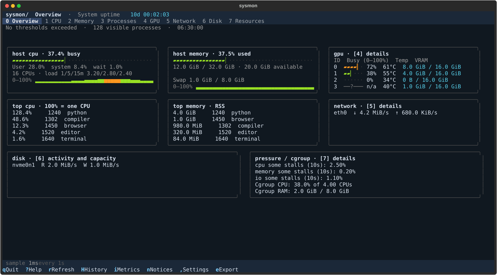

# sysmon

[](https://github.com/pikabell/sysmon/actions/workflows/test.yml)

A **read-only Linux terminal monitor** for CPU, RAM, processes, GPUs, network,
disk activity, storage capacity, resource pressure and cgroup limits.
No root privileges, process controls, background daemon or network service.

The overview puts CPU and memory first, followed by GPU activity, traffic and the
largest processes. Gauges show **0–100%** with separate filled and empty glyphs,
numeric values and recent CPU/RAM history. Unknown metrics show `n/a`, `-` or `?`.
System uptime stays in the header. GPU jobs show full local process start times
beside their PID. All monitoring runs as a regular user.



[80-column preview](docs/overview-80.svg). Previews use reproducible fixture data.
[GPU jobs](docs/gpu.svg), [disk](docs/disk.svg), [pressure and quotas](docs/resources.svg),
and [history](docs/history.svg) previews show the additional views.

## Install

Requires Linux, Python **3.10+**, readable `/proc`, and a UTF-8 terminal.
The base package has no native extensions and needs no compiler, CUDA SDK,
NVIDIA utilities, systemd or particular distribution package manager.

```sh
git clone https://github.com/pikabell/sysmon.git
cd sysmon
uv sync
uv run sysmon
```

Or install the public source directly onto your PATH:

```sh
uv tool install git+https://github.com/pikabell/sysmon.git
sysmon
```

Or use standard Python:

```sh
python3 -m venv .venv
.venv/bin/pip install .
.venv/bin/sysmon
```

[INSTALL.md](INSTALL.md) covers installation, optional acceleration and troubleshooting.

```sh
sysmon                 # Overview
sysmon --panel 4       # GPU details
sysmon --check         # read-only Linux capability report
sysmon --help-keys
sysmon --version
sysmon --panel 6       # disk throughput, filesystem capacity and inode usage
sysmon --panel 7       # pressure and cgroup resource accounting
sysmon --refresh 0.5   # override the saved refresh interval
sysmon --export report.json  # private JSON snapshot; commands omitted
```

## Controls

| Key | Action |
| --- | --- |
| `0` | Overview |
| `1` / `2` / `3` / `4` / `5` | CPU / Memory / Processes / GPU / Network |
| `6` / `7` | Disk / Resources (pressure and cgroups) |
| Left / Right, `h` / `l` | Previous / next panel |
| Up / Down, PgUp / PgDn, Home / End | Scroll the view |
| Shift+Left / Shift+Right | Scroll wide tables horizontally |
| Tab / Shift+Tab | Move focus between tables and scroll regions |
| `/` | Focus process filter |
| Enter / Esc | Apply filter and return to table |
| `s` / `S` | Cycle sort / reverse direction |
| `c` | Show current sort |
| `g` | Toggle compute-only GPU processes |
| Enter / `d` | Inspect selected process or GPU job |
| `H` | Expand session history and select a metric |
| `i` | Explain metrics in the current panel |
| `,` | Save refresh interval, default panel, theme, hidden interfaces and thresholds |
| `e` | Export a fresh JSON snapshot |
| `r` | Refresh |
| `?` / `q` | Help / quit |

Digits and arrows edit text while the filter is focused. Header clicks sort tables.
Filtering matches PID, user, command, state and displayed start time.

## Metric definitions

**CPU:** Busy includes user/nice, system, interrupts and steal; it excludes idle
and iowait. Guest time is already in user/nice and is not counted twice. Core IDs
come from procfs, including sparse/hotplugged IDs. Iowait is approximate kernel
accounting, not disk throughput. Load averages cover 1/5/15 minutes; compare them
with the logical CPU count. Optional frequency may describe one core.

**Memory:** Used = total minus available. Available includes reclaimable memory
and differs from completely free RAM. Cache, buffers, slab and dirty pages overlap;
they are not extra segments to add to the gauge. Older kernels without
`MemAvailable` use an estimate from free RAM, buffers and reclaimable cache.
Swap occupation alone does not measure current swapping activity.

**Processes:** CPU uses tick deltas; **100% means one logical CPU**, so
multithreaded jobs can exceed 100%. RSS can double-count shared pages. Start time
uses boot time plus kernel start ticks; age remains consistent across monitor
restarts. Recycled PIDs get a new baseline. Overview rankings contain at most five
processes above 1% CPU or 64 MiB RSS; the full table lists visible processes.
Process ages use uptime so wall-clock adjustments do not distort them. Inspection
shows parent, command, status, threads, cumulative I/O, open-file targets and limits;
it reports permission failures and checks process identity before and after reading.
Open-file targets are never opened. Detail lists are bounded (128 files, 256 threads).

**GPU:** NVIDIA uses optional NVML for device telemetry and native process VRAM
queries. Unsupported process queries fall back to timed `nvidia-smi pmon`.
AMDGPU busy/VRAM and hwmon data use readable DRM/sysfs attributes. Intel/other DRM
devices show identity and supported sensors; unavailable utilisation stays unknown.
Sysfs does not provide GPU process accounting. `SM%` and `MEM IO%` are activity
percentages when supplied by pmon, not percentages of allocated VRAM.
`STARTED (LOCAL)` means process creation, including seconds; it does not track
the first GPU kernel launch. Enter opens the same process details as panel 3.

**Network:** RX/TX use monotonic byte-counter deltas. Resets/new interfaces do not
create negative rates. Error totals are lifetime counters; overview notices use
**new errors since the previous sample**. Overview traffic excludes loopback.
Socket owners follow kernel permissions; missing owners are `-`. Optional psutil
speeds up enumeration; procfs is the base fallback.

**Disk:** Read/write rates and IOPS use `/proc/diskstats` deltas; sectors are 512
bytes. New devices and counter resets need a baseline. Busy time is not an SSD
saturation measure. Partitions and stacked devices overlap and are not summed.
Filesystem capacity refreshes every 10 seconds; used% excludes root-reserved blocks
from user-available capacity. Inode usage is independent of byte usage. Remote,
FUSE and unsupported filesystem capacity queries are skipped to avoid hanging reads.

**Pressure:** Linux PSI reports the percentage of time some tasks or all non-idle
tasks were stalled over 10/60/300 seconds. It is not utilisation. System-wide CPU
full pressure is undefined. Missing kernel features or denied reads stay unavailable.

**Cgroups:** Panel 7 shows this monitor's cgroup and descendants. CPU% uses CPU-time
deltas divided by elapsed time and effective visible CPU capacity. Capacity considers
affinity/cpuset and the smallest visible ancestor quota, including fractional CPUs.
Memory capacity is the smallest visible hard limit capped by host RAM; the gauge
uses cgroup memory usage. Both v2 and legacy v1 are supported. Limits shared with
siblings are caps, not reserved resources or a measure of current headroom. Hidden
ancestors and other containers cannot be inspected. Host counters remain labelled.

**History:** `H` expands per-interface, per-GPU, disk, pressure, CPU and memory
history. Only sampled panels contribute; the overview collects all these systems.
The default retains 600 points per metric in memory, up to 256 metrics. Percentages
use a fixed 0–100% scale (higher values clip); rates adapt to their displayed peak.
Sampling failures remain gaps. History is not persisted or collected by a daemon.

Notices describe configurable monitor thresholds, not a complete health diagnosis. GPU
78/83°C defaults are generic policy, not vendor throttling limits. A GPU doing
work at 100% is not an incident. Missing required counters report an error.

## Linux compatibility

Standard Linux `/proc` and optional `/sys` replace distribution-specific tools.
The pure Python wheel is architecture-independent. This targets broad Linux
support, **not a guarantee for every kernel, driver or restricted environment**.

- GPU hardware and vendor libraries/utilities are optional.
- `hidepid`, process/socket permissions and namespaces can limit visibility.
- Containers show their accessible namespaces. Host CPU/RAM and quota-aware cgroup
  gauges are separate; invisible ancestor limits cannot be inferred.
- Required procfs counters must be readable; GPU/sysfs data is optional.
- An 80×24 terminal is recommended; narrow views scroll vertically and tables
  scroll horizontally.

Locally tested: Ubuntu 24.04 x86-64, Python 3.10–3.14, unprivileged, with and
without psutil, plus four NVIDIA Quadro RTX 5000s. Base installs and metric/UI tests
also pass in Ubuntu 22.04/24.04, Debian 12, Fedora 43 and Alpine 3.21 containers.
These share the host kernel. AMD/Intel sysfs, missing values, guest time and PID
reuse have fixture tests. Native Ubuntu ARM64 also passed all 42 regression/UI tests
in GitHub Actions. CI checks Python 3.10–3.14, five distribution images, static checks
and isolated wheel installs. See [RELEASE.md](RELEASE.md).

## Settings and exports

Press `,` to save settings to `$XDG_CONFIG_HOME/sysmon/config.json`, or
`~/.config/sysmon/config.json` by default. Loading settings creates no files.
`--config /path/config.json` selects a different file. Invalid settings give a clear
error. Saved intervals affect all panels; the default panel applies next launch.

Exports are explicit local writes, never uploads. `e` opens a destination dialog;
`--export PATH` saves without opening the UI. Existing files are not overwritten.
Files use owner-only permissions. Process commands (including socket commands) are
omitted unless the checkbox or `--include-commands` is selected. Reports still contain
visible names, users, mounts, metrics and socket addresses; review before sharing.

## Development

```sh
uv sync --extra test
uv run --extra test python -m unittest discover -s tests -p 'test_*.py'
uv run --extra test python tests/test_sources.py
uv run --extra test python tests/test_layout.py
uv run --extra test python tests/smoke.py
uv run python tests/preview.py
uv build
```

Blocking reads run on worker threads. Shared collection is serialized, including
threads left by cancelled pollers. Warm-up finishes before visible polling starts.
Only the visible panel polls. Tables update incrementally. Sources live in
`src/sysmon/sources`; views live in `src/sysmon/panels`. Telemetry readers never
write to procfs/sysfs or send process signals.

Licensed under the [MIT License](LICENSE). Copyright 2026 Arjun Badola.
